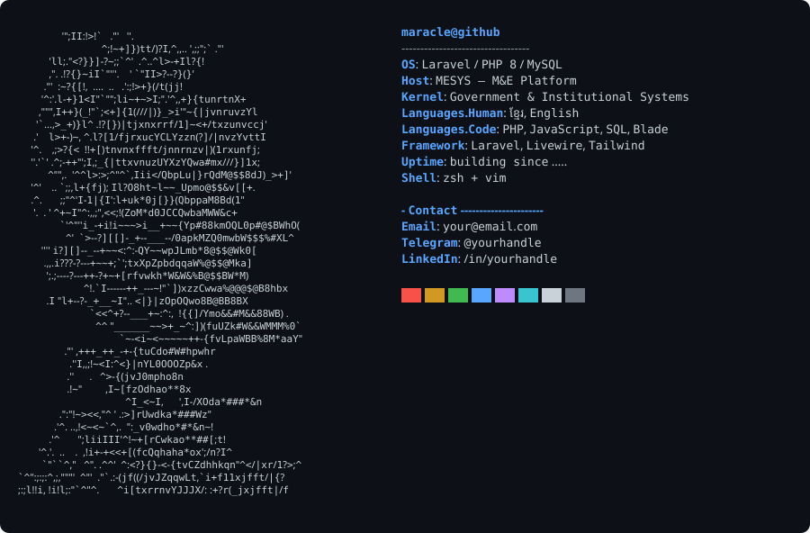

  <picture>
    <source media="(prefers-color-scheme: dark)" srcset="./dark.svg">
    <source media="(prefers-color-scheme: light)" srcset="./light.svg">
    
  </picture>

### Highlights
- 🏛️ Building **MESYS** — Khmer-language monitoring & evaluation platform
- ⚙️ Laravel · PHP · MySQL
- 🌐 ខ្មែរ · English

  
  

