<div align="center">



<!-- ===== NEOFETCH BANNER: ប្តូរឈ្មោះឯកសារដើម្បីប្តូរបែប =====
     variant: mono | color | dots | photo      theme: shadow | blood | arise
     ឧ. ./neofetch/photo-arise.svg -->


<a href="https://git.io/typing-svg"></a>


</div>

<br/>

<div align="center">

</div>

<br/>

## 👤 「 PLAYER PROFILE 」

```yaml
👤 Name: Luy
🌍 Country: Cambodia 🇰🇭
🎓 Role: Student & Full Stack Developer
⚔️ Title: Shadow Monarch Developer
🔥 Passion: Building Powerful Applications

📚 Current Training:
  - Microservices Architecture
  - Docker & Cloud Systems
  - Backend Engineering
  - System Design

🎯 Main Quest:
  Become Elite Software Engineer
```

<div align="center">

</div>

<br/>

## 🗡️ 「 ARSENAL 」

<div align="center">

**Languages**


**Backend & Frontend**


**DevOps & Cloud**


**Data & Tools**


</div>

<br/>

## 📊 「 BATTLE STATS 」

<div align="center">


</div>

<br/>

## 🐍 「 CONTRIBUTION DUNGEON 」

<div align="center">

<picture>
  <source media="(prefers-color-scheme: dark)" srcset="https://raw.githubusercontent.com/YOUR_USERNAME/YOUR_USERNAME/output/github-snake-dark.svg">
  
</picture>

</div>

<br/>

## 👑 「 CURRENT QUESTS 」

<div align="center">

```diff
+ Building Full Stack Projects
+ Learning Cloud Infrastructure
+ Exploring Scalable Systems
+ Improving Coding Skills
+ Creating Legendary Applications
```

</div>

<br/>

## 📡 「 SUMMON ME 」

<div align="center">

[](https://t.me/YOUR_HANDLE)
[](mailto:your@email.com)
[](https://linkedin.com/in/YOUR_HANDLE)
[](https://facebook.com/YOUR_HANDLE)

<br/>


</div>
